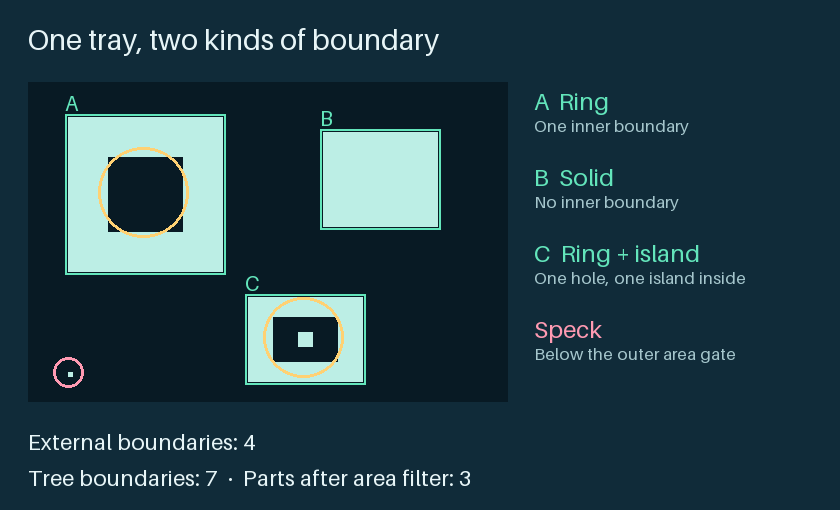

# OpenCV Contour Detection: Count Holes in Parts

A Python lab that inspects synthetic parts using the hierarchy returned by OpenCV.
It compares outside outlines with a full tree, applies separate area gates, and
shows why a touching pair can be reported as one silhouette. The lab runs without
a camera, robot, or graphical desktop.

Full lesson: [OpenCV contour detection at WIFA Robotics](https://wifarobotics.com/learn/opencv-contour-detection/).



## Start from zero

1. Install [Python 3.12](https://www.python.org/downloads/).
2. On GitHub, select **Code → Download ZIP**. Unzip the download and open a terminal in the folder containing `contours.py`.
3. Create an isolated environment and install dependencies. The OpenCV package is the headless build because the lab writes files and JSON rather than opening windows.

Linux and macOS:

```sh
python3.12 -m venv .venv
source .venv/bin/activate
python -m pip install -r requirements.txt
```

Windows PowerShell (no activation required):

```powershell
py -3.12 -m venv .venv
.\.venv\Scripts\python.exe -m pip install -r requirements.txt
```

On Windows replace `python` in the commands below with `.\.venv\Scripts\python.exe`.

## Run five cases

```sh
python contours.py --fixture tray
python contours.py --fixture tray --min-outer 1
python contours.py --fixture dark-tray
python contours.py --fixture dark-tray --dark
python contours.py --fixture touching
```

| Case | External boundaries | Tree boundaries | Parts after gates | What to look for |
| --- | ---: | ---: | ---: | --- |
| Tray | 4 | 7 | 3 | The speck and small island fail the outer area gate. |
| Tray with outer gate 1 | 4 | 7 | 4 | The 3 × 3 island is a depth 2 foreground part. |
| Dark tray, wrong polarity | 1 | 4 | 2 | The first reported shape spans the image border. |
| Dark tray, inverted | 2 | 3 | 2 | A ring and a solid both sit clear of the border. |
| Touching parts | 1 | 2 | 1 | The bridge joins two silhouettes. The ring hole remains. |

Exact JSON is in `examples/`. Bounding boxes are `[x, y, width, height]` in
pixels from the top left. `outer_area_px2` is the contour polygon area, not a
count of white pixels. `direct_holes` counts immediate inner boundaries before
the hole gate; `qualifying_holes` counts the subset at or above that gate.
`no-qualifying-hole` does not mean the image had no hole at all.

To inspect a saved image, start with an 8 bit grayscale PNG and inspect the
generated mask:

```sh
python contours.py --image sample.png --threshold 127 --mask-out mask.png
```

Choose a new mask filename for each run. The CLI refuses to overwrite any file.
Add `--dark` for a dark part on a bright background.

## Tests and troubleshooting

```sh
python -m unittest discover -s tests -v
```

The tests compare tree counts against independent pixel flood fill on 120
deterministic masks and check an analytic rectangle, nested islands, polarity,
hole gates, bridges, invalid input and PNG output. To reproduce the diagrams:

```sh
python -m pip install Pillow==13.0.0
python diagrams/render.py
```

- **No module named cv2:** use the same environment for the install and the run.
  Use a fresh environment if multiple OpenCV packages are installed.
- **The whole frame appears:** check the mask first. Compare default polarity
  with `--dark`; a part really can touch the border, so inspect the flag.
- **A real hole disappears:** see whether it is dark, enclosed and still present
  in the mask. Compare `direct_holes` with `qualifying_holes` before lowering the gate.
- **Two pieces become one:** check whether their white regions are joined. The
  area gates do not split silhouettes.
- **Image rejected:** export a single channel 8 bit grayscale PNG. A visually
  gray RGB image and a 16 bit PNG have the wrong data layout for this tool.

The fixtures contain exact pixel shapes, with no lens blur, shadows, noise,
motion, or calibration uncertainty. This project has no live camera or actuator
interface and has not been validated on hardware. Area gates need fresh
validation at the intended resolution, pose and lighting. Do not use the report
as a safety signal or an automatic robot permission.

Sources: [OpenCV contours](https://docs.opencv.org/4.13.0/d4/d73/tutorial_py_contours_begin.html),
[contour hierarchy](https://docs.opencv.org/4.13.0/d9/d8b/tutorial_py_contours_hierarchy.html),
[shape API](https://docs.opencv.org/4.13.0/d3/dc0/group__imgproc__shape.html),
and [image thresholding](https://docs.opencv.org/4.13.0/d7/d4d/tutorial_py_thresholding.html).
